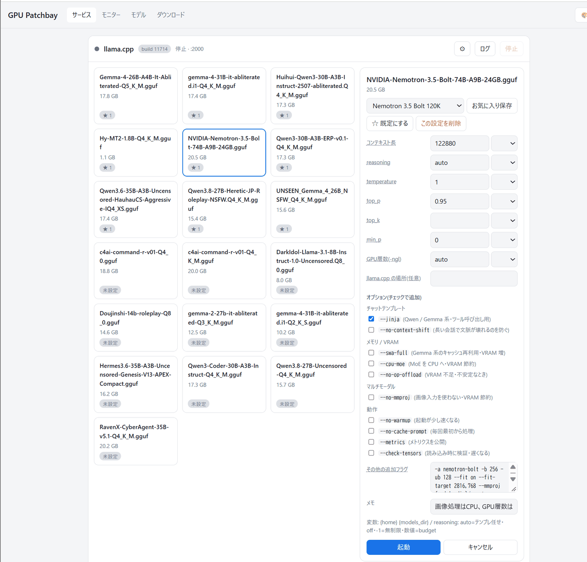
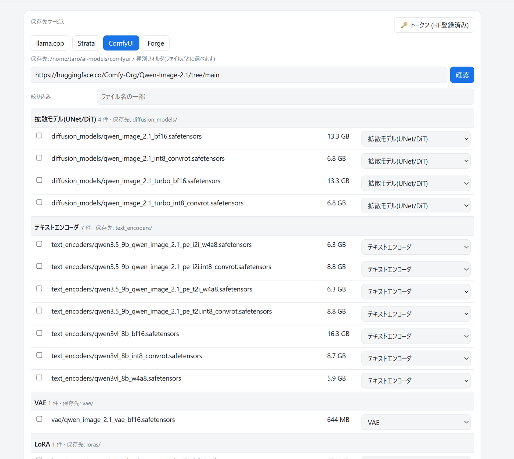
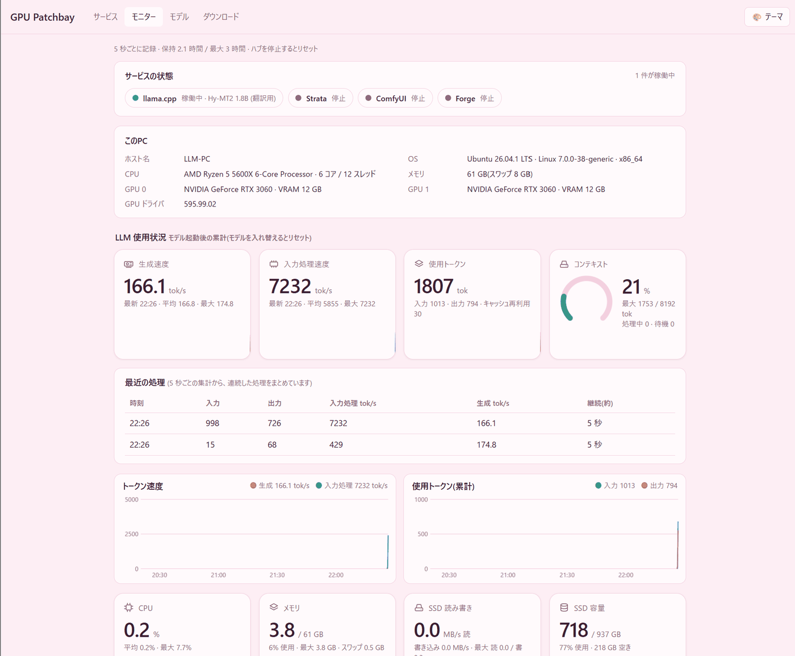
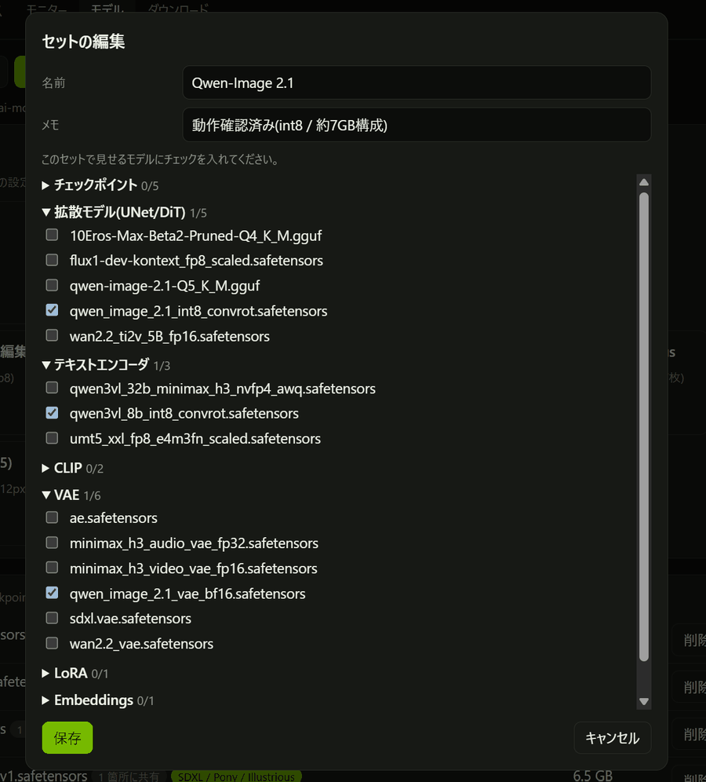
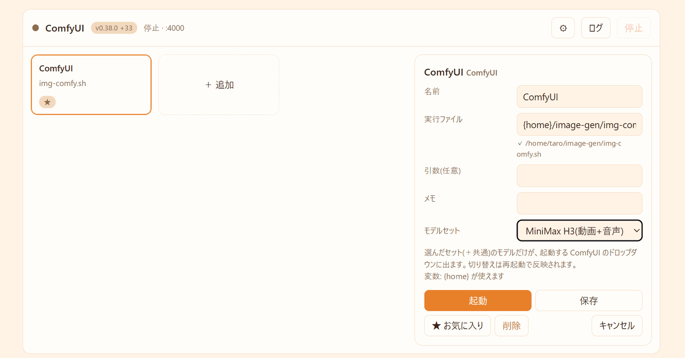

# GPU Patchbay Home AI

> *Home GPU Patchbay for Local AI — one GPU, one AI at a time.*

## はじめに
　最近、ローカルLLMが流行っています。沢山のソフトウェア、沢山のモデル、色々試す方も多いと思います。沢山試していくと、徐々にモデルの切り替えなどが大変です。
特に私のような一般人の多くはGPUもたくさん持っていない人も多く、わざわざ切り替えが必要になることも多々あるかと思います。
そこで、ローカルで動かす AI のソフト(llama.cpp / Strata / ComfyUI / Stable Diffusion WebUI Forge など)を、**ブラウザの1画面から起動・停止・切り替え**するためのダッシュボードを作成しました。
※Claude君に超働いてもらいました。
> 日本語のみ(多言語化の予定はありません)。ライセンスは [MIT](LICENSE)にしています。(改変・商用利用も自由)。

📖 **仕様書(設計・API・設計レビュー)**: <https://nanashi-i.github.io/gpu-patchbay-home-ai/>

## 画面

### サービスの起動・切り替え(llama.cpp)

モデルをタイルで選び、右のパネルで、パラメータ(コンテキスト長・temperature など)とオプションを調整して起動します。**お気に入り**として保存もできます。



### ダウンロード

Hugging Face の URL を貼って「確認」を押すと、ファイルの一覧が出ます。ComfyUI / Forge では、**種別(拡散モデル・テキストエンコーダ・VAE・LoRA など)を自動で判定**して、適切なフォルダに保存します(種別は、ファイルごとに変えられます)。



### モニター

CPU・メモリ・GPU・SSD の使用状況と、llama.cpp 起動中は、トークン速度や使用トークン(LLM 使用状況)を、5秒ごとに記録して表示します。



### モデルセット(ComfyUI / Forge)

そのモデルで使う VAE・テキストエンコーダなどを、**セット**にまとめます。起動するときにセットを選ぶと、そのセットのファイルだけが、ソフトの選択肢に出ます。





## できること

| 機能 | 内容 |
|---|---|
| **サービスの起動・停止** | llama.cpp / Strata / ComfyUI / Forge を、画面のボタンで切り替え。同じグループ(GPU)のサービスは、自動で排他します |
| **LLM のパラメータ調整** | モデルをタイルで選び、コンテキスト長・temperature・top_p などを調整して起動。**お気に入り**として保存できます。`--jinja` などのオプションはチェックボックスです |
| **モデルセット** | ComfyUI / Forge で、選んだセットのモデルだけをドロップダウンに出します(VAE やテキストエンコーダの選び間違いを防ぐ) |
| **モデル管理** | サービスごとにモデルを一覧。削除は、コピー用のコマンドを出すだけで、ダッシュボード自身は消しません |
| **ダウンロード** | Hugging Face の URL を貼ると、ファイルを選んでダウンロード。ComfyUI / Forge では、LoRA・VAE・テキストエンコーダなどの**種別を自動判定**して、適切なフォルダに保存します |
| **モニター** | CPU・メモリ・GPU(複数枚対応)・SSD を5秒ごとに記録して、数字とグラフで表示。llama.cpp 起動中は、トークン速度や使用トークンも出ます |
| **テーマ** | 8種類のカラーテーマ(ダーク、淡い青、グリーン、ガラス調など) |

## 動作環境
- **Linux**(`/proc` と `ss` を使います。macOS / Windows は未対応)
- **Python 3**(標準ライブラリだけで動作可能。確認は Python 3.14 のみ)
- GPU の監視には `nvidia-smi`のみ使用(NVIDIA GPU の場合)
- 管理したいソフトのうち、必要なもの(下の「導入手順」の「2. 使いたいソフトを入れる」を参照)

## 導入手順

### 1. Gitからダウンロードする

```bash
mkdir -p ~/local-ai && cd ~/local-ai          # 親フォルダ(名前は自由。ソフトとモデルも、この中に置きます)
git clone https://github.com/Nanashi-i/gpu-patchbay-home-ai.git
cd gpu-patchbay-home-ai
```

親フォルダは、ホームの直下でなくても、好きな場所・名前でかまいません。**このツールを置いたフォルダの 1 つ上**が、標準の親フォルダになり、その中の `apps/`(各ソフト)と `models/`(モデル)を使います(設定は要りません)。ホームの直下に置くと、`~/apps` と `~/models` になるので、親フォルダを作ることをおすすめします。

### 2. 使いたいソフトを入れる(ソフトの置き場所)

このダッシュボードは、各ソフトの管理だけを行うため、各種ソフト(llama.cpp / ComfyUI / stable-diffusion-webui-forge / Strata)は含まれていません。使いたいソフトを、以下の手順に従って導入してください(あくまで参考手順です。うまく導入できないときは、公式サイトを参照してください)。

| ソフト | 置き場所 | 入れ方 |
|---|---|---|
| [llama.cpp](https://github.com/ggml-org/llama.cpp/blob/master/docs/build.md) | `~/local-ai/apps/llama.cpp/` | ビルドして、`build/bin/llama-server` ができれば OK(下の例) |
| [ComfyUI](https://github.com/comfyanonymous/ComfyUI#manual-install-windows-linux) | `~/local-ai/apps/ComfyUI/` | `venv`(仮想環境)を作って、依存を入れる(下の例)。ダッシュボードは `venv/bin/python main.py` を起動します |
| [Forge](https://github.com/lllyasviel/stable-diffusion-webui-forge) | `~/local-ai/apps/stable-diffusion-webui-forge/` | `git clone` するだけ(下の例)。Python 3.10 / 3.11 が必要です |
| [Strata](https://github.com/Niko1221/Strata) | `~/local-ai/apps/Strata/` | Strata を使う場合のみ(下の例) |

標準の配置は、次のとおりです。

```
~/local-ai/                    親フォルダ(名前は自由。本体の1つ上のフォルダが、標準の親になります)
├── gpu-patchbay-home-ai/      このツール本体
├── apps/                      各ソフト: llama.cpp / ComfyUI / stable-diffusion-webui-forge / Strata
└── models/                    モデル(ダッシュボードが自動で作ります): llama / strata / comfyui / forge
```

- 標準の場所にソフトがあれば、そのまま動きます。
- **別の場所にある場合**は、ダッシュボードの各サービスの **⚙** から、インストール場所を指定します。標準の場所に無くても、ホーム直下などによくある場所を探して、見つかれば「これを使う」と提案します。
- 使わないサービスは、⚙ で「使わない」にすると、「未導入・非表示のサービス」にまとまります。
- 設定ファイルを直接書く人は、`machine.json` に `root` / `apps_root` / `models_root` を書くと、置き場所を変えられます(省略すると、本体の 1 つ上のフォルダが親になり、その中の `apps/` と `models/` を使います。→ [仕様書](https://nanashi-i.github.io/gpu-patchbay-home-ai/))。

モデルは、後回しでも構いません(手順 4 で、画面から入れられます)。

#### ・llama.cppの導入

NVIDIA GPU の例です。ほかの GPU は、[公式のビルド手順](https://github.com/ggml-org/llama.cpp/blob/master/docs/build.md)に従ってください。

```bash
git clone https://github.com/ggml-org/llama.cpp ~/local-ai/apps/llama.cpp
cd ~/local-ai/apps/llama.cpp
cmake -B build -DGGML_CUDA=ON
cmake --build build --config Release -j
```

#### ・Strataの導入

```bash
git clone https://github.com/Niko1221/Strata ~/local-ai/apps/Strata
```

その後は、[Strata の README](https://github.com/Niko1221/Strata) の手順に従ってください。ダッシュボードは、`~/local-ai/apps/Strata/` の中の `run-*.sh` を、起動できるものとして一覧に出します(起動用のスクリプトは、ご自身で用意してください)。

#### ・ComfyUIの導入

```bash
git clone https://github.com/comfyanonymous/ComfyUI ~/local-ai/apps/ComfyUI
cd ~/local-ai/apps/ComfyUI
python3 -m venv venv
# 先に PyTorch を入れます。コマンドは、公式の表示どおりに(https://pytorch.org/get-started/locally/ で、Pip・Linux・お使いの CUDA を選ぶ)
venv/bin/pip install torch torchvision torchaudio --index-url https://download.pytorch.org/whl/cuXXX    # cuXXX は、お使いの CUDA に合わせる
venv/bin/pip install -r requirements.txt
```

#### ・Forgeの導入

venv と依存は、初回の起動で、ダッシュボードが作ります(時間がかかります)。

```bash
git clone https://github.com/lllyasviel/stable-diffusion-webui-forge ~/local-ai/apps/stable-diffusion-webui-forge
```

### 3. ダッシュボードを起動する

```bash
./start.sh            # バックグラウンドで起動して、URL と PID を表示します
./stop.sh             # 停止します
```

```
GPU Patchbay を起動しました。PID: 12345
    http://127.0.0.1:5000
ログ: ~/.local/state/gpu-patchbay-home-ai/hub.log   停止: ./stop.sh
```

表示された URL をブラウザで開きます(初期設定では <http://127.0.0.1:5000>)。

初回起動時に、`machine.example.json` と `presets.example.json` から、設定ファイル `machine.json` と `presets.json` が自動で作られます。これが、あなたの設定です(`.gitignore` で、公開されないようになっています)。

### 4. モデルを入れる

モデルは、手で置かなくても、画面から入れられます。

1. 手順 3 で開いた画面の、**ダウンロード**タブで、保存先のサービスを選び、Hugging Face の URL を貼って「確認」→ ファイルを選んで「ダウンロード開始」。保存先のフォルダ(`~/local-ai/models/…`)は、自動で作られます。
2. **サービス**タブで、モデルを選んで「起動」します。ほかのサービスが動いていれば、自動で止まります。

### (オプション)別の端末から使う(LAN に公開する)

自分のPC以外(スマホや別のPC)から画面を開くときの設定です。**すべて `machine.json` に書きます。**

```json
{
  "host": "0.0.0.0",
  "token": "your-secret-token",
  "allowed_hosts": ["my-pc"]
}
```

| キー | 意味 |
|---|---|
| `host` | `0.0.0.0` にすると、LAN の他の端末から届くようになります(初期値は `127.0.0.1` で、自分のPCだけ) |
| `token` | 任意です。設定すると、API に合言葉が必要になります(画面を開くと、初回に入力を求められます)。**半角の英数字と記号だけ**(日本語や空白は使えません)。LAN に公開して、信頼できない端末が同じネットワークにいるなら、設定をおすすめします |
| `allowed_hosts` | 画面を開くときに使う**名前**(ホスト名)の許可リスト。下の表のとおり、**IP アドレスで開くなら、書かなくて大丈夫です** |

`allowed_hosts` は、ほかのサイトからダッシュボードを操作されないための確認(`Host` ヘッダの確認)で使います。

| 開き方 | `allowed_hosts` |
|---|---|
| `http://127.0.0.1:5000` / `http://localhost:5000` | 不要 |
| `http://192.168.1.10:5000`(IP アドレス) | 不要 |
| `http://<このPCのホスト名>:5000` / `http://<ホスト名>.local:5000` | 不要 |
| 上以外の名前(自分で決めた名前、DNS の名前、リバースプロキシのドメインなど) | **必要**(その名前を書く。ポート番号は書かない) |

書き忘れると、画面に「この Host では使えません(machine.json の allowed_hosts に追加できます)」と出ます。設定を書き換えたら、ダッシュボードを再起動してください。

### 起動と停止

| 操作 | コマンド |
|---|---|
| 起動(バックグラウンド) | `./start.sh`(すでに起動していれば、PID と URL を表示するだけです) |
| 停止 | `./stop.sh` |
| 状態の確認 | `./start.sh --status` |
| いまのターミナルで起動(動作の確認用。Ctrl+C で止まる) | `./start.sh --foreground` |
| ログ | `~/.local/state/gpu-patchbay-home-ai/hub.log` |

- 設定(`machine.json`)に誤りがあるときや、ポートが使われているときは、起動せずに、その理由を表示します。
- **`./stop.sh` は、ダッシュボードだけを止めます。** 起動済みの llama-server や ComfyUI などは止まりません(止めるのは、画面の「停止」です)。ダッシュボードを再起動すると、動いているサービスを、そのまま引き継ぎます。

### (オプション)PCの起動時に自動で立ち上げる

systemd のユーザーサービスとして登録します。登録すると、`./start.sh` / `./stop.sh` は、そのサービスを対象にします(**そのフォルダの `hub.py` を登録したサービスだけ**です。別のフォルダにクローンしたものから、別の場所のダッシュボードを止めることはありません)。

```bash
./start.sh --install-service     # 登録して、すぐ起動(PC の起動時にも、自動で立ち上がる)
./start.sh --uninstall-service   # 登録の解除(ダッシュボードは止まります)
```

- 登録後の停止も `./stop.sh` です(`systemctl --user stop gpu-patchbay-home-ai` と同じ。登録は残るので、次の起動時にまた立ち上がります)。
- ログイン前(PC の起動直後)から立ち上げるには、1回だけ `sudo loginctl enable-linger $USER` が必要です。
- ログは `journalctl --user -u gpu-patchbay-home-ai -f` で見られます。
- サービスの定義は、ダッシュボードを再起動しても、サービスのプロセスを落とさない設定(`KillMode=process`)です。

## 基本の使い方

1. **サービス**タブで、使いたいサービスのタイル(llama.cpp ならモデルのタイル)を選び、右のパネルで設定して「起動」します。ほかのサービスが動いていれば、自動で止まります。
2. **モデル**タブで、サービスごとのモデルを確認します。「削除コマンド」は、ターミナルに貼り付けて実行します。
3. **ダウンロード**タブで、保存先のサービスを選び、Hugging Face の URL を入れて「確認」→ ファイルを選択 →「ダウンロード開始」。
4. **モニター**タブで、PC と GPU の状態を確認します。

### モデルセット(ComfyUI / Forge)

ComfyUI や Forge は、モデルが増えるほど、どの VAE やテキストエンコーダを選ぶのかが分からなくなります。**セット**に、そのモデルで使うファイルをまとめておくと、セットを選んで起動したときに、**そのセットのファイルだけ**が、ソフトの選択肢に出ます。

- セットは、モデルタブで作ります。ダウンロードのときに「セットに追加」を選ぶこともできます。
- 起動するセットは、サービスのタイルを選んだときの「モデルセット」で指定します(「すべて表示」なら、今までどおり)。
- 仕組み: 選んだファイルへのシンボリックリンクだけを集めた「表示用フォルダ」を作り、ComfyUI は `extra_model_paths.yaml`、Forge は起動引数で、そのフォルダを見るようにします。

### トークン(Hugging Face / Civitai)

公開されているモデルは、トークンなしでダウンロードできます。利用規約への同意が必要なモデル(gated)や、非公開のリポジトリは、ダウンロードタブの「🔑 トークン」で登録します。トークンは `~/.local/state/gpu-patchbay-home-ai/secrets.json`(本人だけが読める権限)に保存され、リポジトリには入りません。

## 設定ファイルと保存場所

| ファイル | 内容 | 公開 |
|---|---|---|
| `machine.json` | このPC固有の設定(場所・ポート・サービスの定義) | しない |
| `presets.json` | プリセット(起動するときの設定・お気に入り) | しない |
| `sets.json` | モデルセット | しない |
| `machine.example.json` / `presets.example.json` | 上の2つの雛形 | する |
| `~/.local/state/gpu-patchbay-home-ai/` | 実行時の状態: ログ、起動中のプロセス、APIキーとトークン | しない |

## 安全について(重要)

- ダッシュボードは、**設定されたコマンドを実行**するツールです。初期設定では、自分のPCだけから使えます(`host: 127.0.0.1`)。
- **`token`(認証)は任意です。** 認証なしでも起動できます。同じネットワークの全員を信頼できる環境(自宅の LAN など)なら、そのままで使えます。LAN の他の端末から使うには、`machine.json` の `host` を `0.0.0.0` にします。**このとき認証がなければ、LAN の誰でも、起動・停止・ダウンロード(つまり、設定されたコマンドの実行)ができます。** 信頼できない端末がいるなら、`token` を設定してください。
- **入力は、型を検証してから使います。** API の入力、プリセット、`machine.json` は、型・長さ・制御文字(改行など)を確認し、想定外のものは受け付けません。`machine.json` の型の誤りは起動時にエラー、未知のキーは警告です。コマンドは、シェルを通さずに実行します。
- **ほかのサイトからの操作も防ぎます。** ブラウザで開いている別のサイトから、ダッシュボードに命令を送り込まれないように、`Host` / `Origin` を確認し、POST は JSON だけを受け付けます。そのため、IP アドレスと、このPCのホスト名以外の**名前**で開くときは、`machine.json` の `allowed_hosts` にその名前を書いてください(→ 「別の端末から使う」)。
- **ダウンロードの安全**: URL は `http` / `https` だけです。**内部のアドレス**(このPC・LAN・リンクローカル)への接続は、既定で断ります(NAS など、LAN 内から取りたいときは、`machine.json` に `"allow_private_downloads": true`)。HF / Civitai のトークンは、それぞれの正規のドメインへの https の通信にだけ付けます。保存先は、サービスのモデル置き場の中の、許可した拡張子のファイルだけです。同じ保存先へのジョブは、重ねて登録できず、すでにあるファイルは上書きしません。`.part` などがリンクのときは、書き込みません。
- 削除は、ダッシュボードからは行いません。コマンドを表示するだけです。
- トークンと API キーは、`~/.local/state/gpu-patchbay-home-ai/secrets.json`(権限 600)に保存します。起動した内容を表示するログやプリセットには、秘密を入れないでください(`args` や `extra` に書いた文字列は、画面とログに出ます)。

## フォルダ構成

```
gpu-patchbay-home-ai/
├── hub.py                 起動の入口(python3 -m patchbay と同じ)
├── patchbay/              サーバー本体(標準ライブラリのみ)
│   ├── core/              基礎: 設定・保存・秘密情報・プリセット・プロセス・起動の流れ
│   ├── apps/              アプリごとの知識: llama / strata / comfyui / forge、共通部品(_common)
│   ├── downloads/         ダウンロードの仕組み(キュー・再開・HF の解析)
│   ├── monitor/           PC のモニター(CPU・メモリ・GPU・SSD)
│   └── api/               HTTP の入口(ルート表・認証・画面とテーマの配信)
├── web/                   画面(ビルド不要)
│   ├── index.html         骨組みだけ
│   ├── css/               base.css と、themes/(1ファイル=1テーマ)
│   └── js/                画面ごとの JavaScript(ES モジュール。入口は main.js)
├── tests/                 テスト(標準ライブラリの unittest)
├── tools/                 check_names.py(Python)/ check_js.py(画面): 簡易チェック、hubenv.sh(start/stop の共通部品)
├── start.sh / stop.sh     ダッシュボードの起動(バックグラウンド)・停止 / systemd サービスの登録(オプション)
├── machine.example.json   設定の雛形
├── presets.example.json   プリセットの雛形
└── docs/index.html        仕様書(構成・アプリの約束・API・設計レビュー。GitHub Pages で公開)
```

設計の詳細は、**[仕様書](https://nanashi-i.github.io/gpu-patchbay-home-ai/)**(GitHub Pages で公開。ファイルは `docs/index.html`)を参照してください。

## 開発する人向け

```bash
python3 -m unittest discover -s tests     # テスト(約30秒。start.sh / stop.sh も、別のポートで実際に動かして確認します。実際の設定には触れません)
python3 tools/check_names.py patchbay      # Python: 未定義の名前・未使用の import
python3 tools/check_js.py                  # 画面(ES モジュール): import 漏れ・未使用・循環・構文
```

- **アプリを足す**: `patchbay/apps/<名前>/app.py` に、`App`(スクリプトで動くなら `ScriptApp`)の派生クラスを書き、`patchbay/apps/__init__.py` に登録します。アプリごとの違いは、このフォルダに閉じ込めます。
- **テーマを足す**: `web/css/themes/<id>.css` を置くだけです(先頭の1行のコメントが、メニューの名前と色見本になります)。

## トラブルシューティング

| 症状 | 確認すること |
|---|---|
| サービスが「未導入」になる | ⚙ の「インストール場所」を確認します。目印のファイル(ComfyUI なら `main.py`)があるフォルダを指定します |
| 起動したのに「起動中…」のまま | ログ(サービスのカードの「ログ」)を確認します。ポートが、ソフトが実際に使うものと一致しているかも確認します |
| 起動を押すとエラーになる | 画面の上部に出る赤いメッセージを確認します(モデルが見つからない、など) |
| Forge の venv が作れない | システムの Python に `venv` が無い可能性があります。`launcher.python` で、Python 3.10 / 3.11 を指定します |
| gated モデルで「認証が必要です」 | Hugging Face で利用規約に同意し、「🔑 トークン」でトークンを登録します |

## ライセンスと免責(利用者の責任)

[MIT License](LICENSE) です。Copyright (c) 2026 Nanashi-i。コピー・改変・再配布・商用利用は自由で、条件は「著作権表示とライセンス文を残すこと」だけです。

**このソフトは、無保証で、使うのは利用者ご自身の責任です。** 特に、次の点にご注意ください。

- **コマンドを実行するツールです。** ダッシュボードは、設定されたプログラムの起動・停止、ファイルの作成・上書き、モデルのダウンロードを行います。設定の内容、公開の範囲(`host` / `token` / `allowed_hosts`)、実行するコマンドは、利用者が責任をもって管理してください(→ 「安全について」)。
- **設定とデータのバックアップは、利用者が取ってください。** `machine.json` `presets.json` `sets.json` と `~/.local/state/gpu-patchbay-home-ai/` は、画面の操作で書き換わります。このソフトの使用によって生じたデータの損失・損害・費用について、作者は責任を負いません。
- **ダウンロードするモデルには、それぞれのライセンス・利用規約があります。** Hugging Face や Civitai などから取得するモデルの利用条件(商用利用の可否、年齢制限、生成物の扱いなど)の確認と遵守は、利用者の責任です。ダッシュボードは、これらを確認も保証もしません。
- **取得するトークン(Hugging Face / Civitai)や API キーは、利用者が管理してください。** 漏えいや、第三者による利用について、作者は責任を負いません。
- **別のソフトとは無関係です。** llama.cpp、Strata、ComfyUI、Stable Diffusion WebUI Forge、NVIDIA、Hugging Face、Civitai などの名前は、対応するソフトやサービスを説明するために使っており、各権利者による承認・提携・推奨を意味しません。これらは、それぞれのライセンスで提供される、別のソフトです(このリポジトリには、含まれていません)。

このリポジトリは、標準ライブラリだけで作っており、外部のコードを含みません。
